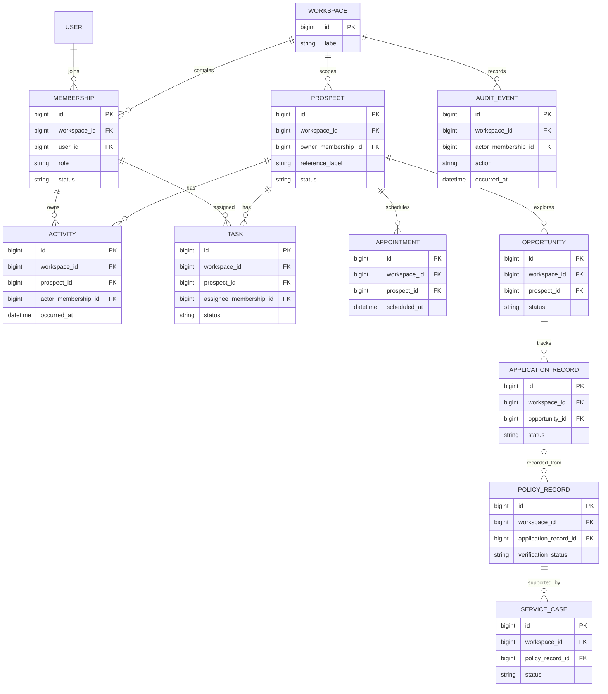

# Agent operations blueprint
Status: design for the next implementation. Only the public availability screen and deny-by-default API boundary exist today.

## Primary journey
Prospect → follow-up → appointment → needs notes → presentation preparation → application tracking → policy records → recurring service / claim assistance.

An agent can perform all future core tasks through structured manual input, checklists, explicit status changes and references. AI may draft optional notes later; it cannot be a condition for completing a task.

## Proposed relational model
Workspace has Memberships connecting User identities to workspace roles. Each Prospect, Activity, Task, Appointment, Opportunity, ApplicationRecord, PolicyRecord and ServiceCase has workspace_id and ownership/assignment. Contact relationships must use composite ownership validation, not accept arbitrary cross-workspace IDs.

Prospect 1:N Activity / Task / Appointment.
Prospect 1:N Opportunity; Opportunity 1:N ApplicationRecord.
ApplicationRecord 0..1:N PolicyRecord (actual provider workflow requires validation).
PolicyRecord 1:N ServiceCase.
Knowledge links refer to approved source versions and concepts; client notes and identities never become public graph nodes.

This is a proposed ERD, not a schema migration or final insurer SOP. Confirm household roles, multiple insured parties, reassignment, team hierarchy and record retention before creating customer tables.

## Lifecycle proposals
- Prospect: new, contacted, appointment, needs discussion, paused, closed.
- Opportunity: preparing, presented, considering, application, closed; closure records a reason rather than assuming a sale.
- ApplicationRecord: preparing, submitted, more information, decided, withdrawn. Final insurer decisions are recorded from an authorized source, never invented by the app.
- PolicyRecord: recorded, awaiting verification, active, service needed, ended; status evidence and effective dates are required.
- ServiceCase: opened, document checklist, sent to official channel, waiting, response recorded, closed. Claim assistance is not claim adjudication.

Transitions require a valid role, ownership scope, required fields, an effective timestamp and an audit event. Status names above must be validated with the actual workflow.

## Proposed access matrix
| Role | Own activity | Assigned team records | All workspace records | Memberships | Editorial content |
| --- | --- | --- | --- | --- | --- |
| Agent | Yes | Only explicitly assigned | No | No | Read allowed material |
| Team lead | Yes | Scoped membership/team assignment | Not automatically | No | Read allowed material |
| Workspace owner | Scoped policy | Scoped policy | Only with explicit operational grant | Manage membership | Read allowed material |
| Editorial admin | No operational grant by default | No | No | No | Manage sources and publication |

User.is_admin and Filament access never imply access to customer records. Authorization must be enforced by Laravel policies on every read/write/export and relationship selection. A client-side hidden menu is insufficient.

## Minimum data and privacy
Start with reference labels, contact channel/consent, owner, next action and timestamps. Do not collect government identity, diagnosis, detailed financial records, personal policies or medical attachments during the first prospect/activity slice. Define retention, withdrawal, restricted logging and signed private downloads before expanding data collection.

Consent should record purpose, channel, version, time and withdrawal. A checked UI box is not a substitute for defining the process. Outbound communication automation requires a separately authorized implementation.

Public knowledge, authorized restricted learning materials and private operational records require separate query scopes, storage paths, cache keys and AI retrieval. Access to a workspace alone does not grant rights to a publisher's restricted playbook.

## Manual templates to validate
1. Appointment preparation: intended topic, source references, questions, next step.
2. Follow-up: date, permitted contact channel, concise notes, assigned owner and next action.
3. Consultation checklist: goals, existing protection context, document/version references, questions still open; avoid storing sensitive details in free text.
4. Presentation checklist: balanced benefits/limits/costs, source version, unresolved questions; no guarantee wording.
5. Service assistance: official procedure reference, document checklist, response reference, follow-up date; never personal medical attachments in public notes.

## Ordered implementation backlog
1. Validate the model; add workspace membership plus login and policies. Test cross-user/team/workspace IDOR, object linking, reassignment and revoked membership.
2. Implement a single manual prospect/activity/task slice and its audit log. Use synthetic fixtures only.
3. Appointment, opportunity and approved material references, then application/policy tracking.
4. Service/claim assistance with evidence-based status records.
5. Separately scoped notification and official insurer integrations, only after availability/authorization is verified.
6. Training/license/CPD reporting if needed. Provider-specific compensation rules and career targets require dated official sources; no automatic commission engine is assumed.

## Present boundary
/agent is a public notice with a link to usable guides. No operational data is rendered. /api/v1/agent/workspace returns 401 for guests and 403 for authenticated users, including admin users. Do not enable it until the policies above exist.
